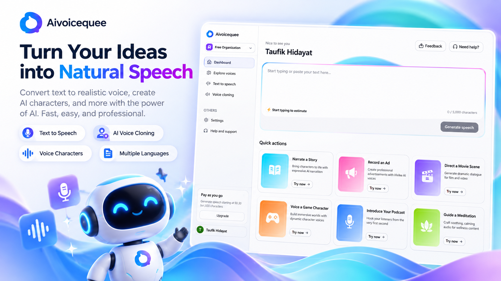

<p align="center">
  
</p>

<h1 align="center">Aivoicequee</h1>

<p align="center">
  <strong>Turn Your Ideas into Natural Speech</strong><br />
  Convert text to realistic voice, create AI characters, and clone voices — fast, easy, and professional.
</p>

<p align="center">
  <a href="https://nextjs.org"></a>
  <a href="https://react.dev"></a>
  <a href="https://www.typescriptlang.org"></a>
  <a href="https://trpc.io"></a>
  <a href="https://www.prisma.io"></a>
  <a href="https://tailwindcss.com"></a>
</p>

<p align="center">
  
</p>

---

## ✨ Features

| Feature | Description |
| ------- | ----------- |
| **Text to Speech** | 5,000-character editor with voice selector, creativity controls (temperature, top-p, top-k, repetition penalty), WaveSurfer playback, history & detail view |
| **AI Voice Cloning** | Upload (20 MB max, min. 10s validated) or record in-browser via microphone, with signed audio previews |
| **Voice Library** | 12 curated categories (Audiobook, Conversational, Characters, Podcast, Advertising, …), multi-language support, searchable system + custom voices |
| **Quick Actions** | 6 one-click templates: Story Narration, Ad Recording, Movie Scene, Game Character, Podcast Intro, Meditation Guide |
| **Organizations** | Multi-tenant workspaces powered by Clerk (sign-in / sign-up / org-selection enforced) |
| **Billing & Metering** | Polar checkout + portal, subscription-gated generation, per-character / per-voice usage metering |
| **Cloud Storage** | Cloudflare R2 for voices & generations with short-lived signed URLs |

## 🛠️ Tech Stack

**Frontend:** Next.js 16 (App Router) · React 19 · TypeScript 5 · Tailwind CSS 4 · shadcn/ui + Radix UI · TanStack Query / Form · nuqs · WaveSurfer.js · RecordRTC

**Backend:** tRPC 11 + superjson · Prisma 7 + PostgreSQL · Clerk Auth (orgs) · Polar Billing · AWS SDK v3 (R2) · Zod 4

**AI Inference:** Chatterbox Turbo TTS (`chatterbox-tts`) hosted on Modal (`gpu=a10g`, FastAPI, API-key auth), synced via OpenAPI (`npm run sync-api`)

**Observability:** Sentry (server / edge / client)

## 🚀 Getting Started

### Prerequisites

- Node.js 20+ and npm
- PostgreSQL database
- Accounts / keys: Clerk, Polar, Cloudflare R2, Modal + Hugging Face token (for the TTS model)

### 1. Install

```bash
git clone https://github.com/taufik2992/ai-saas-voice.git
cd ai-saas-voice
npm install
```

### 2. Configure environment

Copy `.env.example` to `.env` (or create `.env`) and fill in:

| Variable | Required | Description |
| -------- | -------- | ----------- |
| `DATABASE_URL` | ✅ | PostgreSQL connection string |
| `APP_URL` | ✅ | e.g. `http://localhost:3000` |
| `NEXT_PUBLIC_CLERK_PUBLISHABLE_KEY` / `CLERK_SECRET_KEY` | ✅ | Clerk auth keys |
| `POLAR_ACCESS_TOKEN` / `POLAR_SERVER` / `POLAR_PRODUCT_ID` | ✅ | Polar billing (`sandbox` for dev) |
| `POLAR_METER_TTS_GENERATION` / `POLAR_METER_VOICE_CREATION` / `POLAR_METER_TTS_PROPERTY` | ✅ | Polar meter IDs |
| `R2_BUCKET_NAME` / `R2_ACCESS_KEY_ID` / `R2_SECRET_ACCESS_KEY` / `R2_ACCOUNT_ID` | ✅ | Cloudflare R2 storage |
| `CHATTERBOX_API_URL` / `CHATTERBOX_API_KEY` | ✅ | Modal TTS endpoint + key |

> Tip: set `SKIP_ENV_VALIDATION=1` to bypass env validation during Docker/CI builds.

### 3. Database + seed

```bash
npx prisma migrate deploy
npx prisma generate
npx tsx scripts/seed-system-voices.ts
```

### 4. Deploy the TTS model (Modal)

```bash
modal deploy chatterbox_tts.py
npm run sync-api
```

### 5. Run

```bash
npm run dev
```

Open [http://localhost:3000](http://localhost:3000) — sign in, select/create an organization, and start generating.

| Script | Command |
| ------ | ------- |
| Dev | `npm run dev` |
| Build | `npm run build` (`prisma generate && next build`) |
| Start | `npm start` |
| Lint | `npm run lint` |
| Sync TTS API types | `npm run sync-api` |

## 📁 Project Structure

```
app/
  (dashboard)/          # Dashboard, text-to-speech, voices, billing
  api/audio/            # Signed audio streaming
  api/voices/           # Voice upload / preview
features/
  text-to-speech/       # Editor, sliders, history, player
  voices/               # Library, recorder, create dialog
  dashboard/            # Sidebar, header, quick actions
  billing/              # Checkout, portal, gating
trpc/routers/           # voices · generations · billing
prisma/schema.prisma    # Voice / Generation models (Postgres)
lib/                    # r2, chatterbox-client, env
chatterbox_tts.py       # Modal + Chatterbox Turbo TTS server
scripts/                # seed-system-voices, sync-api
public/thumbnail.png    # README / social preview
```

## 🧠 How It Works

```
Text / Voice sample → Next.js + tRPC (org-scoped, subscription-checked)
  → Chatterbox Turbo on Modal (GPU) → MP3/WAV → Cloudflare R2
  → Polar meter ingest (chars / voices) → Signed URL playback
```

## 🗺️ Roadmap

- [ ] Streaming TTS playback
- [ ] More languages & emotion controls
- [ ] Public API keys
- [ ] Team roles & usage quotas

## 🤝 Contributing

Issues and PRs are welcome. Please run `npm run lint` and `npm run build` before submitting.

## 📄 License

Private / All rights reserved for now — add a `LICENSE` file if you plan to open-source it.

---

<p align="center">
  Built with Next.js, tRPC, Prisma, Clerk, Polar, and Chatterbox TTS.
</p>
